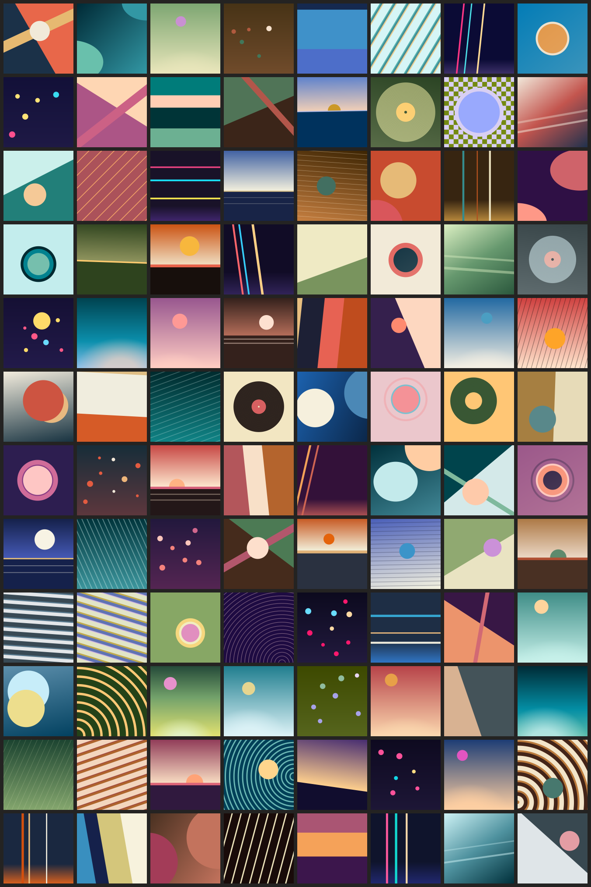

# sleeve

sleeve makes stand-in album covers: abstract, flat-colour artwork for a record that has none. A
64-bit seed becomes a cover's *description*, a small plain-data value: an opaque base colour and up
to twelve paint layers of linear, radial and checker gradients with hard or soft colour stops.
The description rasterizes to any size, anti-aliased, and writes out as SVG and PNG.

It is one C file, `sleeve.h`, in the manner of single-file libraries such as clay.h. It has no
dependencies beyond the C standard library, allocates nothing, and keeps no global state.



## Using it

```c
#define SLEEVE_IMPLEMENTATION   /* in exactly one translation unit */
#include "sleeve.h"

sleeve_cover cover;
static uint8_t pixels[256 * 256 * 4];
sleeve_generate(sleeve_hash("Album\tArtist", 12), &cover);
sleeve_render(&cover, 256, 256, pixels, 256 * 4);
```

| Call | What it does |
| --- | --- |
| `sleeve_hash(bytes, length)` | A stable 64-bit seed for any identity: FNV-1a, then MurmurHash3's finalizer. |
| `sleeve_generate(seed, &cover)` | The cover for a seed. |
| `sleeve_check(&cover)` | 0 when the renderers accept a description, -1 otherwise; for descriptions made by hand. |
| `sleeve_render(&cover, w, h, rgba, stride)` | Rasterizes into the caller's RGBA8 buffer, opaque, the square stretched to w × h (1 to 16384 each). |
| `sleeve_render_rows(&cover, w, h, row0, row1, rgba, stride)` | The same for a range of rows, to spread a large cover over frames or threads. |
| `sleeve_svg(&cover, w, h, out, capacity)` | The cover as an SVG document; returns its length as `snprintf` does, so a capacity of 0 sizes the buffer. |
| `sleeve_png_bound(w, h)`, `sleeve_png(rgba, w, h, stride, out, capacity)` | Encodes pixels as an 8-bit RGB PNG into the caller's buffer; the bound is always enough. |
| `sleeve_describe(&cover, out, capacity)` | The description as text, one line per layer. |
| `sleeve_composition_name(i)`, `sleeve_mood_name(i)` | Names for a generated cover's composition and mood. |
| `sleeve_write_png(path, &cover, w, h)`, `sleeve_write_svg(...)` | Render and write a file; left out when `SLEEVE_NO_STDIO` is defined, which also drops `<stdio.h>` and `<stdlib.h>`. |

## The description

Lengths are integers in units of the cover's side, `SLEEVE_UNIT` (10000) being the whole side;
angles are whole degrees. Each layer paints over everything before it:

- **linear** is CSS's `linear-gradient`: its line runs through the centre at `angle` degrees
  clockwise from straight up, `|sin| + |cos|` sides long, and a stop's `at` is its distance
  from the line's start;
- **radial** has rings around (`cx`, `cy`), a point's distance being `sqrt(dx² + (dy·ex/ey)²)`,
  so `ex` and `ey` set an ellipse's proportions;
- **checker** has squares `ex` on a side, the square with its corner at (`cx`, `cy`) in the
  first stop's colour and its neighbours in the second's.

Colours are 8-bit sRGB with straight alpha. Between two stops the colour is interpolated in
premultiplied sRGB; two stops at one position make a hard edge. A repeating layer starts at 0 and
repeats every last stop's distance. Every generated description passes `sleeve_check`.

`sleeve describe` prints the text form:

```
sleeve 1 disc duotone
palette #023e5b #037cb6 #efe2cc #e19342 #aabde8
base #037cb6
radial 5000 5000 10000 10000 : #e19342ff@0 #e19342ff@2104 #efe2ccff@2104 #efe2ccff@2403 #efe2cc00@2403
linear 141 : #efe2cc00@0 #efe2cc3c@14065
```

### What the generator draws

A seed picks one of ten *moods*, each a palette recipe in OKLCH (dusk, sea, earth, warm and cool
paper, neon, mist, garden, duotone, ember), and draws five colours from it: deep, mid, pale and two
accents, each pulled into the sRGB gamut by lowering its chroma. It then picks one of twelve
*compositions* and draws its parameters: a horizon with a sun and lines in the ground; a glow
rising from the bottom edge; rings or a record with grooves and a label; a pair of reels;
repeating stripes; proportional bands or a translucent sheen; a hard diagonal split; thin neon
bars; a constellation of dots; repeating grooves from an off-centre point; two large orbs; a
checkerboard under a disc or a band. The neon mood keeps to the compositions where its bright
accents stay small marks on a dark ground.

## Determinism

- The same seed gives the same description, byte for byte, on every platform and compiler, for
  as long as `SLEEVE_GENERATOR` stays the same: generation uses only integer arithmetic, a
  SplitMix64 stream seeded through MurmurHash3's finalizer, and lookup tables (cosines, the sRGB
  transfer function). The version changes whenever any seed's cover would.
- `sleeve_hash` is fixed: `sleeve_hash("", 0)` is `0xefd01f60ba992926` and
  `sleeve_hash("sleeve", 6)` is `0xf6f05973edcde22c`, on every platform.
- A raster is the same within one 8-bit level on every platform. It is computed in single
  precision with the operations in a fixed order; a compiler that fuses multiplies and adds into
  FMA instructions can move a channel by one level. Built without FMA, x86-64 natively and
  WebAssembly give identical bytes.

## The rasterizer

Each pixel takes each layer's exact average over the pixel's square. Along a gradient a square's
footprint is a box convolved with a box, a trapezoid, and the colour between stops is linear, so
the average is an integral of a piecewise-quadratic product: Simpson's rule evaluates it exactly,
piece by piece, and where a footprint lies inside one piece the colour at its centre is the
average. Radial layers are treated as locally straight, and pixels within two footprints of a
centre are split 4 × 4. Repeating layers integrate whole periods, up to 32, and use the period's
mean beyond. Checkers are exact. Layers composite with source-over in premultiplied sRGB, which
leaves one known error: where two layers' edges cross one pixel, their coverages conflate, as in
browsers.

## File formats

- **SVG**: a `viewBox` of `0 0 10000 10000` stretched to the requested size, one full-cover
  `rect` per layer filled with a `linearGradient` or `radialGradient` in user space (ellipses
  through a `gradientTransform`, repetition through `spreadMethod="repeat"`), and checkers as
  square paths (a `<pattern>` beyond 4096 squares). It renders the same picture as the raster;
  the SVG check states how close.
- **PNG**: 8-bit RGB, one zlib stream of fixed-Huffman deflate with run-length matches, each row
  filtered with whichever of the five filters gives the smallest absolute sum. Covers come out at
  roughly a fifth of their raw size.

## The command-line tool

```sh
make                                   # build/sleeve and build/check
build/sleeve cover --size 512 --out cover.png key:'Album Title'
build/sleeve cover --svg --out covers/ 1 2 3
build/sleeve sheet --size 160 --columns 8 --first 1000 96 sheet.png
build/sleeve describe 7
build/sleeve seed key:'Album Title'
```

A seed is a decimal number, a `0x` hexadecimal one, or `key:TEXT` for `sleeve_hash` of TEXT's
bytes. `cover` writes one file to `--out`, or several into the directory it names, each named by
its seed; `sheet` writes COUNT covers from `--first` on, in a grid, as one PNG.

## Building

`sleeve.h` is C99 and builds without warnings under `-Wall -Wextra -Wpedantic -Werror`:

| Target | Compiler | Command |
| --- | --- | --- |
| Desktop | GCC or Clang | `cc -std=c99 -O2 -o sleeve tools/sleeve.c -lm` |
| Android | the NDK's Clang | `aarch64-linux-android29-clang -std=c99 -O2 -o sleeve tools/sleeve.c -lm` |
| WebAssembly | wasi-sdk's Clang | `clang --target=wasm32-wasi -std=c99 -O2 -o sleeve.wasm tools/sleeve.c -lm` |

The library itself calls only `sqrtf`, as a compiler builtin, and needs `-lm` only when built
without optimization. Built by GCC or Clang with `SLEEVE_NO_STDIO` defined, it depends on no
C library at all.

## Checks

`make check` builds `build/check` and runs it; `make faults` shows each check failing on a
deliberately faulty copy of `sleeve.h`, for the reason it predicts. `scripts/offline-gate` at the
repository's root runs `make check`.

| Check | What it holds | Fails on |
| --- | --- | --- |
| descriptions | 21 seeds' text descriptions, and a digest of seeds 0–19,999, equal the goldens in `tests/golden/` | mood weights changed |
| rasters | one cover per composition at 64 px is within one level of its golden PNG | interpolating with the square of the fraction |
| antialiasing | 55 layers alone and 24 whole covers at 48 px against a 64 × 64-sample double-precision reference: layers worst 4 levels and mean 0.5; covers mean 0.6, at most 0.2 % of channels off by more than 8 | point sampling |
| png | 40 images of awkward sizes decode with the vendored stb_image to exactly the pixels encoded; one byte too little capacity is refused | a wrong filter byte |
| svg | 48 covers rendered by `rsvg-convert` at 16× and averaged down are within mean 0.6, 0.2 % of channels beyond 8, worst 48 of the raster (skipped without a renderer) | circles drawn for ellipses |
| variety | over 20,000 seeds, compositions and moods keep their shares within 12 %, runs of neighbouring seeds look random, palettes cover the hue circle, no two covers repeat, and neighbouring seeds look different | uniform composition weights; unmixed seeds |
| api | row ranges equal the whole raster, invalid inputs are refused, sizing calls agree, the hash is fixed | a translucent base |

## Why C

sleeve's language was settled by measurement: Haskell if, on every host measured, it generated
and rasterized within 1.25× of C's time, otherwise C. `bench/` holds the measurement: a Haskell
port written for speed (strict loops over unboxed arrays, nothing allocated per pixel) that
produces identical descriptions and rasters, a harness that times both on the same 1,000 seeds at
64, 216 and 512 px, and the runners for each host. `results/20261020T1931Z-language/` holds the
reports. Haskell took 1.20–1.53× C's time natively on the desktop and 2.2× in a browser, so the
library is C; the Haskell port stays in `bench/` only as the measurement's comparison, built and
checked against `sleeve.h` by `bench`'s own `check`, and is not maintained as a second
implementation.

## Licence

Released into the public domain under the Unlicense; see [UNLICENSE](UNLICENSE). The checks vendor
stb_image (`third_party/stb/`), which is public domain or MIT.
